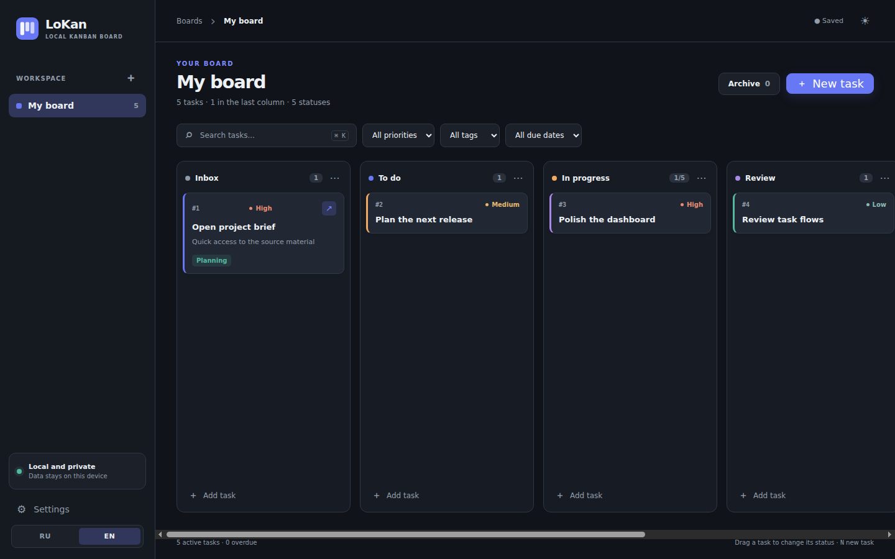
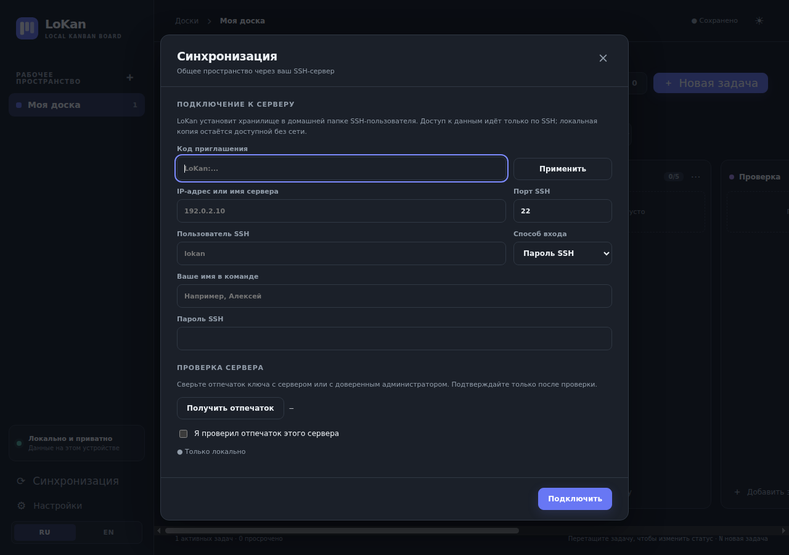

# LoKan — Local kanban board

Локальная канбан-доска для Windows, macOS и Linux на Electron. Работает без аккаунта и сети; при желании синхронизирует доски через ваш SSH-сервер для совместной работы. Интерфейс доступен на русском и английском языках.

**[Скачать LoKan для своей системы](https://github.com/nesfe/LoKan/releases/latest)**

| Система | Файл релиза |
| --- | --- |
| Windows x64 | `LoKan-*-win-x64.exe` |
| macOS Apple Silicon | `LoKan-*-arm64.dmg` |
| macOS Intel | `LoKan-*-x64.dmg` |
| Linux x64 | `LoKan-*.AppImage` |

Для Linux разрешите запуск AppImage через свойства файла или `chmod +x`. Сборки Windows и macOS пока без сертификата разработчика: система может показать предупреждение при первом запуске.



## Возможности

- Несколько независимых досок, настраиваемые статусы и лимиты задач.
- Последовательные номера `#1`, `#2`, … внутри каждой доски. Удалённые номера не переиспользуются.
- Перетаскивание карточек между колонками и внутри колонки.
- Приоритеты, сроки, цветные карточки и теги, описания и чек-листы.
- Поле **«Ссылка»** в задаче. Название и значок ↗ на карточке открывают веб-ссылку в браузере; нажатие на остальную часть карточки открывает редактор. Поддерживаются `http://` и `https://`; для адреса без протокола добавляется `https://`.
- Поиск по номеру, названию, описанию, ссылке и тегам; фильтры по приоритету, тегу и сроку.
- Архив с восстановлением, светлая и тёмная темы, переключатель RU/EN под настройками.
- Автоматическое локальное сохранение, резервная копия, экспорт и импорт JSON.
- Необязательная синхронизация через SSH с собственным сервером. Несколько участников видят общие доски, могут назначать исполнителя, видеть автора последней правки, работать офлайн и получать изменения после подключения.
- Горячие клавиши: `N` — новая задача, `Ctrl/Cmd+K` — поиск, `Esc` — закрыть окно.

## Запуск из исходников

Требуются Node.js 20+ и npm.

```bash
npm ci
npm start
```

Для проверки модели данных: `npm test`. Для сборки установщика: `npm run dist:win` на Windows, `npm run dist:linux` на Linux или `npm run dist:mac` на macOS. Готовые файлы появятся в `dist/`. GitHub Actions собирает все четыре варианта релиза.

## Хранение данных

Файл `lokan.json` лежит в локальном каталоге данных приложения Electron (`userData`), а предыдущая версия — в `lokan.backup.json`. Точный путь показан в настройках. Запись выполняется через временный файл и переименование. Для локальной работы отдельная БД не нужна: весь набор досок хранится в одном файле, который можно экспортировать.

Импорт **заменяет** текущие доски. Перед импортом можно сделать экспорт. Без включённой синхронизации задачи не отправляются по сети; открытие ссылки передаёт её браузеру по нажатию пользователя.

## Синхронизация и команда



Нужен Linux-сервер с работающим SSH и Python 3, доступный по IP-адресу или имени. В **Настройки → Синхронизация** укажите адрес, SSH-пользователя и пароль либо файл закрытого SSH-ключа. Приложение покажет отпечаток ключа сервера: сверьте его с сервером перед первым подключением. LoKan автоматически установит небольшой скрипт в `~/.local/share/lokan-sync/` этого пользователя и создаст там базу SQLite `boards.sqlite3`. Открывать отдельный порт или запускать постоянный веб-сервис не нужно.

Чтобы пригласить коллегу, нажмите **Копировать приглашение**. Код содержит адрес, порт, имя SSH-пользователя и отпечаток сервера, но не содержит пароль или закрытый ключ. У коллеги должен быть свой SSH-доступ к **тому же Unix-пользователю** (например, собственный публичный ключ в его `authorized_keys`). После подключения у всех будут общие доски. Для нескольких разных Unix-пользователей общее хранилище автоматически не настраивается.

Передача защищена SSH и проверкой закреплённого отпечатка сервера. Закрытый ключ остаётся в выбранном файле на устройстве; пароль сохраняется с помощью системного хранилища Electron, если оно доступно и безопасно. Если такого хранилища нет, пароль действует только до закрытия приложения и при следующем запуске его нужно ввести снова. На сервере данные лежат в обычной SQLite-базе под правами SSH-пользователя и **не зашифрованы на диске**. Делайте резервные копии сервера и используйте доверенный сервер.

Локальные изменения доступны без сети. После восстановления связи LoKan объединяет правки разных задач и разных полей; при одновременной правке одного поля последняя синхронизированная правка побеждает. Новые задачи получают уникальные номера внутри доски. Локальный экспорт JSON остаётся доступен для резервного копирования.

## English

LoKan is a local-first desktop kanban board for Windows, macOS, and Linux. [Download the latest release](https://github.com/nesfe/LoKan/releases/latest). It includes multiple boards, customizable statuses and WIP limits, numbered tasks, drag and drop, priorities, due dates, colors, tags, descriptions, checklists, search, filters, archive, and JSON backup. Add a web link to a task and open it directly from the card title or ↗ icon. Switch between English and Russian at the bottom of the sidebar. Optional team sync connects to your own Linux SSH server with Python 3 using a password or SSH key; no public application port is needed. Teammates need SSH access to the same Unix user. Data remains available offline and is stored on the server in SQLite when sync is enabled. The server data is not encrypted at rest.

## Лицензия

MIT.
